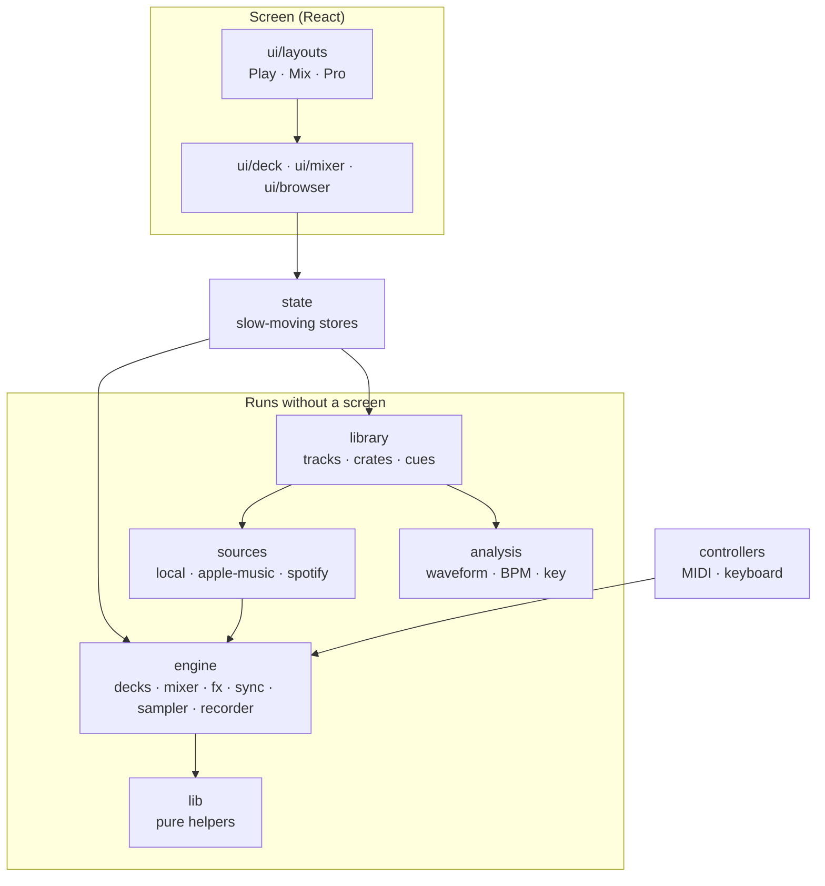
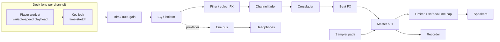

# Architecture

How the code is organised and why. Read this before adding a folder or a dependency. How the
app looks and feels is covered separately in [DESIGN.md](DESIGN.md).

## Shape of the system



Arrows mean "may import from". Nothing points upward: the engine does not know React exists,
and it does not know where a track came from.

## Folders

```
src/
  app/          Composition root. The one place that wires everything together.
  config/       Brand, skill-mode definitions, feature flags. Plain data.
  lib/          Pure helpers (audio maths). Imports nothing else from src/.
  engine/       The audio engine. Plain TypeScript on the Web Audio API.
    core/         Audio context, master bus, clock, shared types (capabilities).
    deck/         One loaded track and its playhead.
    mixer/        Faders, crossfader, EQ, filter, cue bus, master.
    fx/           Effect units and their registry.
    sampler/      Pad bank.
    sync/         Tempo maths, beat grids, sync, quantize, key lock.
    recorder/     Capture the master bus to a file.
    worklets/     Code that runs on the audio thread.
  analysis/     Web Workers: waveform peaks, BPM, beat grid, key.
  sources/      Where music comes from. One folder per source, one contract.
    local/        Files the listener owns. Full decks.
    apple-music/  Listen-only jukebox.
    spotify/      Listen-only jukebox.
  library/      The collection on the device: IndexedDB + origin-private files.
  controllers/  MIDI and keyboard input, mapping files.
  state/        Stores that bridge the engine to React.
  pwa/          Service worker registration, install, wake lock, media session.
  ui/
    theme/        Design tokens and global styles.
    components/   Fader, Knob, Pad, Button, Meter.
    deck/         Platter, waveform, transport, cues, loops.
    mixer/        Channel strips, crossfader, FX panel, pads.
    browser/      Library and jukebox browsing.
    lessons/      Guided lessons and the grown-ups corner.
    layouts/      The three skill-mode layouts and the app shell.
services/
  apple-music-token/   Tiny server-side function that signs Apple Music developer tokens.
public/         Icons, and the starter crate of bundled audio.
tests/e2e/      End-to-end tests. Unit tests sit next to the code as *.test.ts.
docs/           Plan, features, design language, architecture, streaming.
```

Every folder under `src/` has an `index.ts` whose header comment says what belongs there and
which milestone fills it in.

## Rules that are enforced

`eslint.config.js` turns the import rules into errors:

1. `lib`, `engine`, `analysis`, `sources`, `library` and `controllers` cannot import React, a
   state library, or anything from `ui`, `app` or `state`.
2. `lib` and `engine` cannot import from `sources`, `library`, `controllers` or `analysis`.

A unit test (`src/sources/registry.test.ts`) fails if a streaming source is ever given a
capability that would mix, alter, analyse or record its audio.

## Capabilities: how one UI handles very different sources

A deck does not assume it can do everything. Each source declares a `DeckCapabilities` record
(`src/engine/core/types.ts`): can it change tempo, scratch, pass through EQ, show a waveform,
be recorded, sound at the same time as something else?

- Files the listener owns get `FULL_CAPABILITIES`.
- Apple Music and Spotify get `LISTEN_ONLY_CAPABILITIES`.

The UI and controllers read capabilities and hide what is unavailable. No component checks
`if (source === 'spotify')`. Adding a source later means writing one folder and one registry
entry.

## Audio signal flow



The streaming jukebox is deliberately **not in this graph**. It plays through the service's own
player, and the engine silences the master bus while it does.

## Threads

| Thread          | Runs                                                        | Rule                                          |
| --------------- | ----------------------------------------------------------- | --------------------------------------------- |
| Main            | React, engine control surface, canvas drawing               | Never decode or analyse audio here            |
| Audio (worklet) | Deck players, time-stretch, meters                          | No allocation and no locks inside `process()` |
| Workers         | Decoding, waveform peaks, BPM / key analysis, library index | Results are plain transferable data           |

Continuous controls (faders, knobs) are `AudioParam`s, so changes are smoothed and
sample-accurate. Discrete commands (play, cue, load) go over the worklet's message port.

**Fast values never pass through React.** Playhead position, meter levels and platter angle are
read from the engine inside a `requestAnimationFrame` loop and drawn straight to canvas. Stores
in `state/` hold only what changes at human speed.

## Storage

| What                                  | Where                             |
| ------------------------------------- | --------------------------------- |
| Imported audio, cached waveform peaks | Origin-private file system (OPFS) |
| Track records, cues, grids, crates    | IndexedDB                         |
| Preferences                           | localStorage (through `state/`)   |
| App code and bundled crate            | Service worker cache              |

Nothing leaves the device. The app asks the browser for persistent storage once the listener
has imported something worth keeping.

## Browser support

| Capability                  | Chrome / Edge (desktop, Android) | Safari (Mac) | iPhone / iPad (all browsers) |
| --------------------------- | :------------------------------: | :----------: | :--------------------------: |
| Core decks, mixer, effects  |               yes                |     yes      |             yes              |
| Install as an app           |               yes                |     yes      |   yes (Add to Home Screen)   |
| MIDI controllers            |               yes                |      no      |              no              |
| Second audio output for cue |               yes                |  to verify   |              no              |

Every browser on iPhone and iPad uses the same engine as Safari, so that column is the limit
for those devices regardless of which browser is installed.

## Testing

- **Unit (Vitest):** all maths and rules that can be tested without sound: gain curves,
  crossfader laws, tempo and grid arithmetic, capability invariants.
- **Engine (Vitest + OfflineAudioContext, from M1):** render a known signal through the graph
  and assert on the output samples.
- **End-to-end (Playwright, from M8):** install, load, play, mix, go offline.
- **Ears and hands:** every milestone has a "done when" in [PLAN.md](PLAN.md) that is checked
  by a person on a real device.

## Decisions made so far

| Decision                                         | Why                                                                                                 |
| ------------------------------------------------ | --------------------------------------------------------------------------------------------------- |
| Web app (PWA), no native wrapper                 | One codebase for every device, installs without a store, works offline.                             |
| Engine is framework-free TypeScript              | Testable without a browser UI, drivable from MIDI, survives a UI rewrite.                           |
| React for the screen, canvas for anything moving | Familiar to contributors; the hot path bypasses it anyway.                                          |
| Capabilities instead of per-service branches     | Streaming limits are structural; hiding controls beats breaking them.                               |
| Streaming is listen-only                         | The audio is encrypted and both services' terms forbid mixing it. See [STREAMING.md](STREAMING.md). |
| Service worker updates on request only           | An automatic reload could stop the music mid-mix.                                                   |
